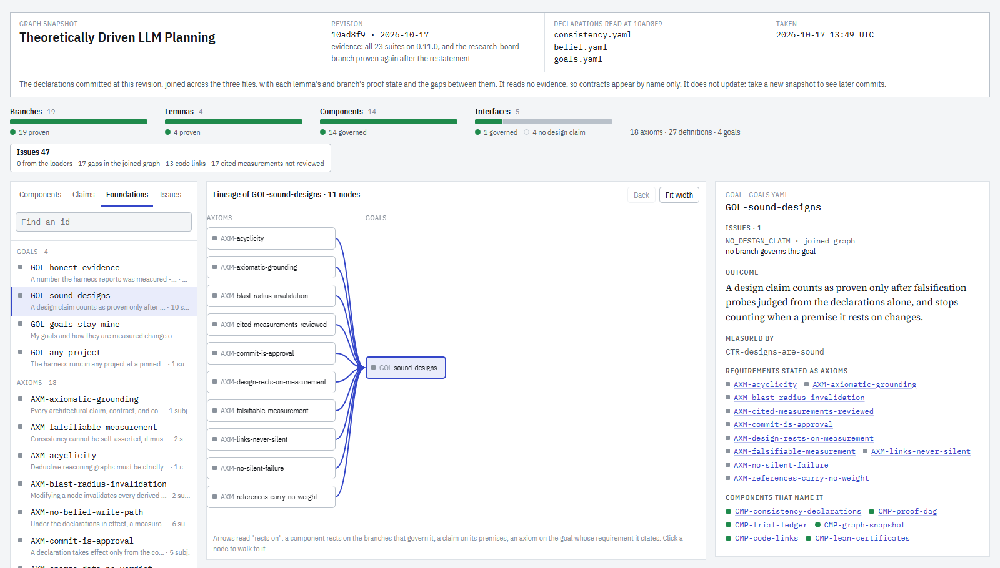

# Theoretically Driven LLM Planning (TDLP)

**Make your AI coding agent prove it.**

TDLP is a Claude Code plugin, which also runs on [Codex and Antigravity](#use-it-with-codex-or-antigravity),
that turns an agent's work into a verifiable engineering process. You
set the goals. The agent designs, builds and tests on its own, and nothing it *says* counts: a
result exists only once a tool has measured it, and a design holds only once it has survived
attempts to refute it.

<picture>
  <source media="(prefers-color-scheme: dark)" srcset="docs/assets/goal-snapshot-v0.11.0-dark.png">
  
</picture>

<sub>**This repository, drawn by its own plugin.** An AI agent built TDLP under TDLP, so the repo is
its own demo. The picture is a goal snapshot, `snapshot(focus="GOL-sound-designs")`, taken at
`10ad8f9` (v0.11.0, 2026-10-17): every design claim proven, every component covered by a design,
and on the left the ten requirements one of its four goals rests on. A snapshot names its commit
and does not update; take one yourself in the [tour](#try-it-in-five-minutes).</sub>

---

## Why it's different

### 1. Verifiable: the agent can't grade its own homework

* **No tool writes a result.** There is no `set_belief` and no `mark_proven`. Evidence comes from
  tests the server runs itself (capturing the output, its hash, and the exact file contents it ran
  on) or from falsification probes recorded by a verifier that cannot open a file. What the agent
  merely asserts is recorded with zero weight.
* **Results expire with the code.** A result stops counting the moment a file it measured changes.
  It stays on record and is marked *stale*; it is not counted until re-run.
* **"Not enough data" is an answer.** Sparse evidence reads `insufficient`, never a pass.
* **Your goals stay yours.** A git hook refuses the agent's commits to `goals.yaml` and the tests
  that measure it. The agent may change everything below your goals, not what they mean.

What that looks like, from this repo's own tools:

```text
status(view="goals")
GOL-sound-designs  MET -- A design claim counts as proven only after falsification probes judged from ...
  CTR-designs-are-sound [unbucketed] supported gate 5/5 passed in RUN-0337 (+65 stale)

status(view="tree")
basis: verification_trials×72 set=f85e8c · proven=23 obligations=0 refuted=0
```

`RUN-0337` is the run the verdict rests on. `+65 stale` counts older results kept on record that no
longer count, because what they measured has changed since.

### 2. Systems-engineered: a V-model, with you at the top

Every stage of the classic V has a home, and each is checked by something other than the agent's
word. Your part is the top row. The agent owns the rest.

| Stage | Declared | Checked by | This repo at `10ad8f9` |
|---|---|---|---|
| **Needs** (yours) | goals, and the interfaces between them, in `goals.yaml` | acceptance tests the agent may not edit | 4 goals, 1 interface: **5/5 met** |
| **Requirements** | axioms and definitions, each axiom naming the goal it serves | every design claim must trace back to them | 18 axioms, 27 definitions, every axiom traced to a goal |
| **Architecture** | components and the interfaces between them, in `belief.yaml` | interface tests | 14 components, 4 interfaces: **4/4 supported** |
| **Design** | lemmas and design decisions, each argued from the requirements | refutation attempts by an independent verifier | 23 claims: **23/23 proven**, 0 refuted |
| **Build and test** | the files each component owns | component tests, run by the server | 14 contracts: **14/14 supported**, 471 cases |
| **Configuration control** | declarations read from the committed revision only | each result stamped with the file contents it ran on | uncommitted edits change no verdict |

It is traced end to end. A design decision names the component it governs and cites the test
contract that measures it, so any change can be walked from a file, through components,
contracts and design claims, to the goals it puts at risk.

### 3. Sticky: a loop the agent keeps running on its own

Each server ships its loop in the instructions Claude Code loads with its tools, and every answer
names the next call. So the agent doesn't stop at "looks done". It diagnoses, runs, re-checks, and
stops only when a policy is met or a decision is yours.

```text
does it work?            status(view="diagnose") → run_test(...)    → status(view="belief")
does the design follow?  status(view="probe")    → verify_step(...) → status(view="tree")
what did my change hit?  git commit              → impact(...)      → "next: run_test TST-..."
am I done?               decide(policy)          → adopt, or more_testing with the shortfall named
```

No test is dropped without a reason. From this repo's `status(view="plan")`:

```text
mandatory (scheduled regardless of information gain):
  - TST-server (e2e, cost 1.0)
  - TST-consistency-server (e2e, cost 1.0)

skipped (every test considered, with its reason):
  - TST-acceptance-designs: not_decision_relevant — policy verdict is identical at both ends of the interval
  ...
```

You check in with a single call, `status(view="goals")`. Approval happens once, when you commit a
goal, not at every step.

---

## What's in the box

One plugin, `tdlp`, with five MCP servers, three workflow skills, a verifier subagent and a
research scout:

| Server | Answers | In plain words |
|---|---|---|
| **component-belief** | Does it work? | runs the declared tests itself and keeps score per contract |
| **consistency-belief** | Does the design follow? | checks that each design decision follows from the stated requirements |
| **stamp-monitor** | Is the evidence still current? | traces what a change touched, and flags tampering and skipped steps |
| **graph-snapshot** | What does the whole design look like? | draws goals, requirements, claims and components as one page (the picture above) |
| **research-board** | What should we try next? | keeps research directions for a goal: the papers behind each, the tweak each suggests, what was spent testing it and what came of it |

---

## Try it in five minutes

The quickest way to see it is this repository, which declares itself. You need
[Claude Code](https://claude.com/claude-code), `git` and [`uv`](https://docs.astral.sh/uv/).

```bash
claude plugin marketplace add davechendatascience/Theoretically_Driven_LLM_Planning
git clone https://github.com/davechendatascience/Theoretically_Driven_LLM_Planning
cd Theoretically_Driven_LLM_Planning
claude plugin install tdlp@davechendatascience-marketplace --scope project
claude
```

The first start builds the five servers and can take a minute or two. This repo's
`.claude/settings.json` already raises the connect timeout to allow for it. Then ask in plain
words, and the agent picks the tools:

| Ask Claude | You get | Tool behind it |
|---|---|---|
| "Are this repo's goals met?" | each goal met, not met, insufficient or stale, with the run that says so | `status(view="goals")` |
| "Take a goal snapshot of GOL-sound-designs." | `.graph-snapshot/snapshot.html`, the page at the top of this README; open it in a browser and click around | `snapshot(focus=...)` |
| "Why is BRN-goal-guard proven?" | its proof tree, down to the requirements it rests on | `status(view="tree", subject=...)` |
| "What did the v0.11.0 release touch?" | changed files, then components, contracts, design claims and policies | `impact(base="c563b34")` |
| "What should be tested next?" | this round's tests, and why every other test was skipped | `status(view="plan")` |
| "Send scouts to look for research directions on GOL-sound-designs." | directions on the research board, each with the papers behind it and the tweaks they suggest, in `.research/BOARD.md` | `board()`, the `research-scout` agent |

**Then break something**, to watch evidence expire:

1. `git switch -c try-it`, add a comment line to `src/component_belief/goals.py`, and
   `git commit -am "try it"`.
2. Ask again whether the goals are met. `GOL-goals-stay-mine` now reads `STALE`: that file belongs
   to the component serving the goal, and the evidence was measured on its old contents.
3. Before anything re-runs, `git switch main` and ask once more. The goal reads met again, with no
   re-run, because evidence is bound to file contents, not to time.

To let the agent re-run this repo's own tests, give the clone an environment first:
`uv sync --extra dev`.

## Use it on your project

```bash
cd /path/to/your/project
claude plugin install tdlp@davechendatascience-marketplace --scope project   # commit .claude/settings.json
```

Add `"env": {"MCP_TIMEOUT": "120000"}` beside `enabledPlugins` in that settings file, then start
Claude Code and run **`/tdlp:adopt-goals`**. The agent reads what your project already tests,
drafts a `goals.yaml` for you, and stops. You review it and commit it yourself. From there:

* the agent declares components and design decisions as it works, and runs the loops on its own;
* `status(view="goals")` is your check-in;
* changing a goal is a commit only you make.

Setup details, moving an older install, and running from source are in the
[guide](docs/guide.md#quick-start).

## Use it with Codex or Antigravity

The plugin is Claude Code's format. Codex and Antigravity run the same five servers from their own
MCP config, and the verifier and the research scout from their own agent files. All of these are in
[`clients/`](clients/), pinned to the same release as the plugin. Fetch them once:

```bash
git clone https://github.com/davechendatascience/Theoretically_Driven_LLM_Planning ~/tdlp
```

**Codex.** Add the servers and the two agents for every project:

```bash
cat ~/tdlp/clients/codex/config.toml >> ~/.codex/config.toml
mkdir -p ~/.codex/agents && cp ~/tdlp/clients/codex/agents/*.toml ~/.codex/agents/
```

Start `codex` from your project; the servers read the directory Codex starts in. To keep this to
one project, put both under that project's `.codex/` instead (Codex reads it once you trust the
project). Codex passes a server only the variables its config names, plus `HOME`, `PATH` and a few
other basics. If your tests need any other variable, forward it with
`env_vars = ["NAME"]` in the `[mcp_servers.component-belief]` table.

**Antigravity.** Copy the five entries under `mcpServers` in
[`clients/antigravity/mcp_config.json`](clients/antigravity/mcp_config.json) into
`~/.gemini/config/mcp_config.json`. Then add the two agents to your project:

```bash
mkdir -p .agents/agents && cp ~/tdlp/clients/antigravity/agents/*.md .agents/agents/
```

The servers ask Antigravity which workspace is open and read that one. The first start at a release
builds the servers, which takes a minute or two, on either agent.

**Then**, in each clone, install the goal guard and ask the agent to send the verifier or a scout by
name, for example "have consistency-verifier verify the open obligations":

```bash
uvx --from "git+https://github.com/davechendatascience/Theoretically_Driven_LLM_Planning@tdlp--v0.13.2" tdlp-guard install
```

What differs between the three:

| | Claude Code | Codex | Antigravity |
|---|---|---|---|
| Servers, and the loop each one names in its instructions | plugin | `config.toml` | `mcp_config.json` |
| Which project the servers read | the one Claude Code names | the directory Codex starts in | the workspace Antigravity names |
| Workflow skills (`/tdlp:adopt-goals` and the rest) | yes | no | no |
| Verifier and scout: tools taken away | all but their own few server tools | the shell | every file and command tool |
| Verifier and scout: tdlp tools in reach | only their own | all; their prompt names their own | all; their prompt names their own |
| How the goal guard knows an agent's commit | the `Co-Authored-By: Claude` trailer | the `Co-authored-by: Codex` trailer | `ANTIGRAVITY_AGENT=1` on the agent's commands; the guard adds the trailer |

On Codex and Antigravity a subagent shares the session's MCP servers, so nothing stops the verifier
from calling a tool outside its three except its prompt. What it can't do is read your code, and on
Claude Code it holds nothing else.

---

## The vocabulary, in plain words

TDLP borrows its terms from proof assistants and systems engineering. Each id prefix names a kind
of thing:

| Term | Plain meaning |
|---|---|
| **goal** (`GOL-`) | an outcome you want, and the test that says it's achieved; yours alone |
| **component** (`CMP-`) | a part of the system, and the files it owns |
| **interface** (`IFC-`) | what one part hands to another, and the check the hand-over must pass |
| **contract** (`CTR-`) | the pass rule a part's test results must meet. A *gate* means every case passes; a *rate* means it passes often enough, with a confidence interval |
| **axiom** (`AXM-`) | a requirement, stated as a premise every design argument must trace back to |
| **definition** (`DEF-`) | a term the requirements use, pinned down |
| **lemma** (`LMA-`) / **branch** (`BRN-`) | an intermediate claim / a design decision, both argued from axioms. A branch governs a component and cites the contract that measures it |
| **probe**, **trial** | one attempt to refute a claim: look for a counterexample, check the conclusion follows, check its negation |
| **proven / doubted / refuted** | survived enough independent attempts / a gap was found / a counterexample was found |
| **obligation**, **conditional** | not yet checked enough / checked, but resting on a step that isn't |
| **evidence**, **ledger** | one recorded test case or trial / the append-only log of all of them (`.belief/`, `.consistency/`), committed to git |
| **stamp**, **stale** | the fingerprint of the exact files a result was measured on / a result whose files have changed since: kept, not counted |
| **insufficient** | too little data for a verdict, reported as such |
| **policy**, **decide** | the release criteria / the call that checks them and records the decision |
| **direction** (`DIR-`), **trail**, **spend** | a line of research toward a goal / a paper and the tweak it suggests to a component / points committed to a direction before its work is done. Only results recorded after a spend count for its direction |

---

## Learn more

* **[The guide](docs/guide.md)**: the full manual. Principles, every tool of every server, how
  the two ledgers join, the systems-engineering mapping, the layout and the test suites.
* **[CHANGELOG.md](CHANGELOG.md)**: release notes, newest first.
* Design notes: [consistency rules](docs/consistency_belief_mcp_design_rules.md) ·
  [component rules](docs/component_belief_mcp_design_rules.md) ·
  [component model](docs/component_belief_mcp_design.md) ·
  [stamp monitor](docs/stamp_monitor_mcp_design.md) ·
  [graph snapshot](docs/graph_snapshot_mcp_design.md) ·
  [code-to-theory tagging](docs/code_to_theory_tagging_design.md)
* This repo's own declarations, for a worked example: [`goals.yaml`](goals.yaml),
  [`consistency.yaml`](consistency.yaml), [`belief.yaml`](belief.yaml).
